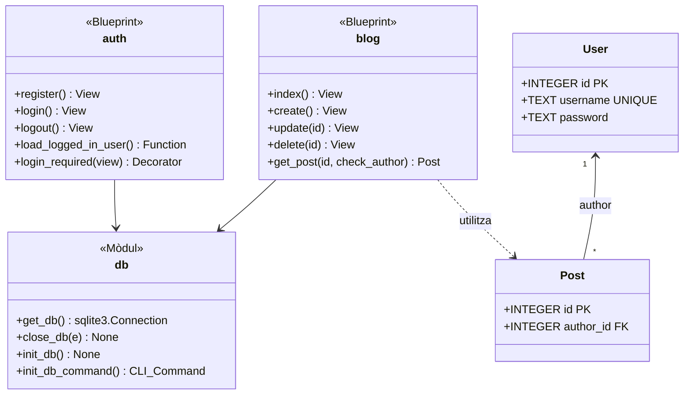

# Diagrama de Components

Descriure tots els components de l´aplicació

Components: db, _init_ , auth, blog

## db
Descripció: Funcions d´accés a BBDD
Mètodes:
- getbd() : Retorna connexió : Mètode que retorna la connexió a BBDD
- close_db() : Tanca la connexió BBDD

